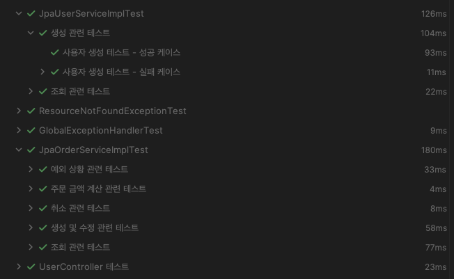
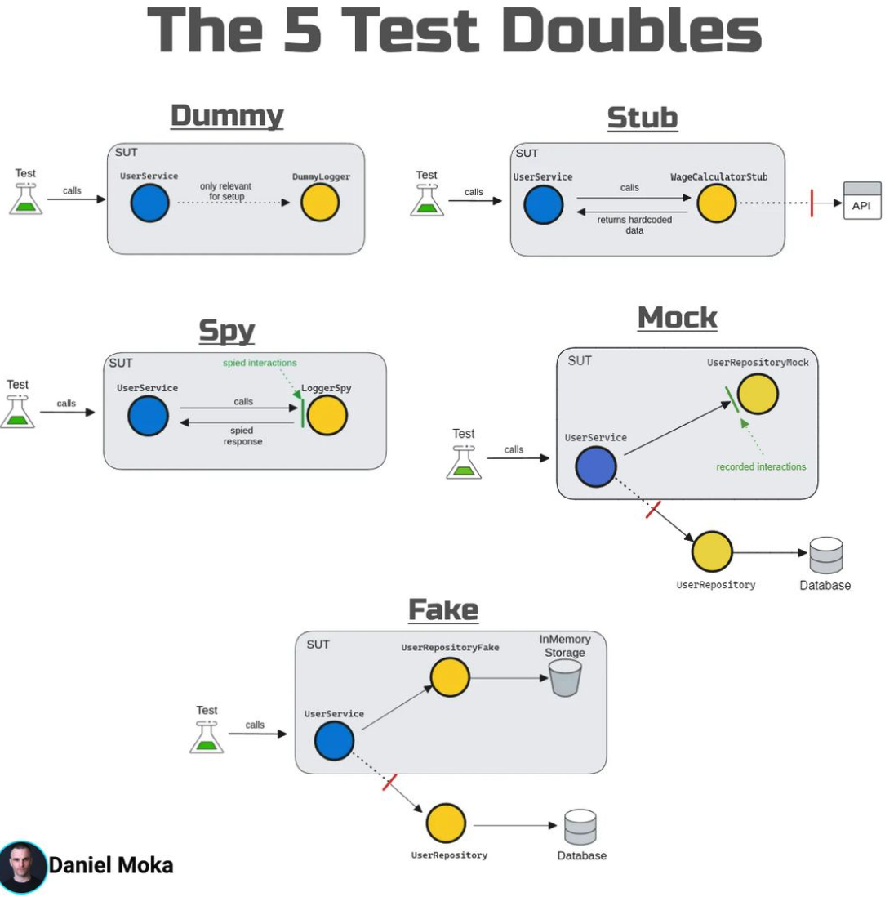

# 2. HOW - 테스트 코드를 어떻게 작성해야 하는가?

## 2.1 테스트 범위 선택하기

먼저 검증하려는 동작을 한 문장으로 씁니다. 주문 조회의 응답 형식이 관심사라면 MVC 슬라이스에서 확인하고, 실패한 주문 요청이 실제 저장 데이터에 어떤 영향을 주는지가 관심사라면 DB까지 연결합니다.

| 테스트 범위 | 확인할 동작 | 저장소 예제 |
| --- | --- | --- |
| 단위 | Spring 컨텍스트 없이 객체의 반환값이나 예외를 검증합니다. | [ResourceNotFoundExceptionTest](../src/test/java/io/github/junhkang/springboottesting/exception/ResourceNotFoundExceptionTest.java) |
| 웹 슬라이스 | `@WebMvcTest`와 `MockMvc`로 요청 매핑, 상태 코드, JSON 응답을 확인합니다. 서비스 빈은 `@MockitoBean`으로 대체합니다. | [OrderControllerTest](../src/test/java/io/github/junhkang/springboottesting/controller/OrderControllerTest.java) |
| JPA 슬라이스 | `@DataJpaTest`로 JPA 구성과 DB를 사용합니다. 서비스까지 확인할 때는 예제처럼 `@Import`로 대상 서비스를 추가합니다. | [JpaOrderServiceImplTest](../src/test/java/io/github/junhkang/springboottesting/service/impl/JpaOrderServiceImplTest.java) |
| 애플리케이션 통합 | `@SpringBootTest`와 `@AutoConfigureMockMvc`로 실제 서비스와 H2를 연결해 요청부터 저장 결과까지 확인합니다. | [OrderQuantitySpecification](../src/test/java/io/github/junhkang/springboottesting/specification/OrderQuantitySpecification.java) |

## 2.2 MockMvc로 HTTP 계약 검증하기

다음은 `OrderControllerTest`의 주문 조회 테스트에서 가져온 검증 코드입니다. Mockito로 준비한 주문을 서비스가 반환하면, `MockMvc`로 Spring MVC에 요청을 보내 응답 상태와 JSON 필드를 확인합니다.

```java
Order order = new Order();
order.setId(1L);
order.setStatus(OrderStatus.PENDING);
Mockito.when(orderService.getOrderById(1L)).thenReturn(order);

mockMvc.perform(get("/orders/1"))
        .andExpect(status().isOk())
        .andExpect(jsonPath("$.id", is(1)))
        .andExpect(jsonPath("$.status", is("PENDING")));
```

```bash
./mvnw "-Dtest=OrderControllerTest" test
```

`MockMvc`는 서버 포트를 열지 않고 Spring MVC를 실행합니다. 실제 HTTP 연결까지 확인하는 시스템 테스트가 필요하면 실행 중인 서버에 요청을 보냅니다. 테스트용 HTTP 클라이언트인 `WebTestClient`도 실제 서버에 연결하거나 Spring의 테스트 환경에 바인딩할 수 있습니다. [WebTestClient 문서](https://docs.spring.io/spring-framework/reference/testing/webtestclient.html)

## 2.3 JUnit Jupiter로 사례 정리하기

- `@Test`는 동작 하나를 검증할 때, `@BeforeEach`는 테스트마다 새 데이터가 필요할 때 사용합니다. 기대값이나 예외는 `assertEquals(expected, actual)`, `assertThrows` 같은 어서션으로 기록합니다.
- 같은 동작을 여러 입력에서 확인할 때는 `@ParameterizedTest`를 사용합니다. 주문 스펙은 `@ValueSource`로 거절할 수량을, `@CsvSource`로 수량·남은 재고·총액의 조합을 전달합니다. [주문 인수 테스트](../src/test/java/io/github/junhkang/springboottesting/specification/OrderQuantitySpecification.java)
- 주문 생성과 변경처럼 사례가 많아지면 `@Nested`로 묶고 `@DisplayName`으로 동작을 표시합니다. `@RepeatedTest`는 동일한 테스트를 여러 번 실행할 때, `@Timeout`은 시간 제한 자체가 요구사항일 때 사용할 수 있습니다. [중첩·반복 테스트 예제](../src/test/java/io/github/junhkang/springboottesting/service/impl/JpaOrderServiceImplTest.java) · [JUnit 애너테이션](https://docs.junit.org/6.0.3/writing-tests/annotations.html)



## 2.4 테스트 더블 고르기

테스트 더블은 실제 의존성을 대신하는 객체입니다. 위 예제에서 `Mockito.when(...).thenReturn(...)`은 서비스가 미리 정한 결과를 반환하도록 설정하는 **스텁** 역할입니다. 호출 자체가 계약에 포함될 때는 **목**의 상호작용을 검증할 수 있습니다. **더미**는 사용하지 않는 자리를 채우고, **페이크**는 메모리 저장소처럼 단순한 동작을 구현하며, **스파이**는 실제 객체를 바탕으로 호출을 기록합니다.



[이미지 출처 · Daniel Moka](https://www.linkedin.com/posts/danielmoka_mocks-are-one-of-the-most-misunderstood-and-activity-7241327748164571136-hGZn/)

이 저장소의 DB 테스트는 H2를 사용합니다. 운영 DB 전용 SQL이나 동작을 검증해야 한다면 Testcontainers로 같은 DB 엔진을 띄우는 통합 테스트를 고려할 수 있습니다. [Testcontainers 문서](https://java.testcontainers.org/)

**다음 장** · [3. 테스트 작성 시점](3.when.md) · [목차](../README.md#학습-순서)