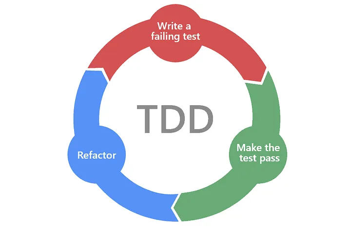

# 3. WHEN - 언제 테스트 코드를 적용해야 하는가?

## 3.1 신규 기능을 구현하기 전

BDD(Behavior-Driven Development)의 Given–When–Then 형식으로 상황, 행동, 기대 결과를 예시로 합의합니다. 주문 변경의 경우 **Given** 주문 수량이 2개이고 남은 재고가 3개일 때, **When** 수량을 5개로 바꾸면, **Then** 주문 수량은 5개이고 남은 재고는 0개가 됩니다. [주문 스펙의 ORD-03](5.spec-driven-development.md#51-주문-수량-스펙)

이 예시를 TDD(Test-Driven Development)의 레드–그린–리팩터 사이클로 구현할 수 있습니다.

1. **레드** — 테스트를 작성하고 요구사항이 아직 충족되지 않아 실패하는지 확인합니다.
2. **그린** — 동작을 구현해 새 테스트와 관련 테스트를 통과시킵니다.
3. **리팩터** — 테스트를 다시 실행하면서 중복을 줄이고 구조를 개선합니다.

[이미지 출처 · Applying Test-Driven Development](https://medium.com/pilar-2020/applying-test-driven-development-6d6d3af186cb)

## 3.2 버그를 수정할 때

수정하기 전에 버그를 재현하는 테스트를 작성합니다. 예를 들어 0개 주문이 받아들여졌다면, HTTP 400을 반환하고 재고가 유지되는지 확인하는 테스트를 추가합니다. 수정 후 같은 테스트가 통과하면 회귀 테스트로 유지합니다. [수량 검증을 추가한 사례](5.spec-driven-development.md#53-실패를-확인하고-구현하기)

## 3.3 기존 코드에 테스트를 추가하거나 리팩터링할 때

1. 변경할 코드가 제공하는 API나 서비스 메서드에서 이미 유지해야 할 동작을 찾습니다.
2. 의도한 동작을 기존 코드에서 통과하는 테스트로 고정합니다. 의도가 불명확한 결과는 요구사항을 확인한 뒤 기대값으로 기록합니다.
3. 내부 구조를 조금씩 바꾸고 관련 테스트를 다시 실행합니다. 동작 자체를 바꾸는 작업은 새 기대값과 테스트가 드러나도록 분리합니다.

당장 모든 사례를 다루기 어렵다면 자주 변경되고 실패 비용이 큰 동작부터 시작합니다. 주문 예제에서는 주문 총액과 재고의 일관성을 먼저 확인할 수 있습니다.

**다음 장** · [4. 테스트 범위](4.how-deep.md) · [목차](../README.md#학습-순서)
