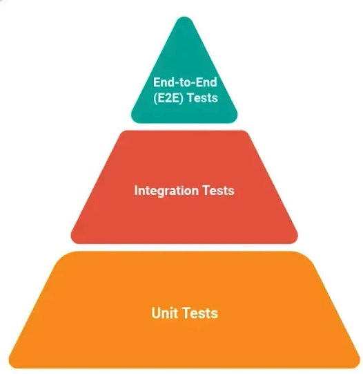

# 4. HOW DEEP - 얼마나 깊게 테스트 코드를 작성해야 하는가?

## 4.1 실패했을 때의 영향으로 범위 정하기

테스트 피라미드는 빠르게 실행할 수 있는 단위 테스트를 넓게 두고, 여러 계층이 필요한 동작에 통합 테스트와 시스템 테스트를 사용하는 전략입니다. 주문 예제에서는 응답 형식에 웹 슬라이스를, 주문과 재고가 함께 저장되는지 확인하는 데 통합 테스트를 사용합니다. 실제 서버나 외부 시스템과의 연결이 요구사항이면 그 경계도 포함합니다. [테스트 범위별 예제](2.how.md#21-테스트-범위-선택하기)

[이미지 출처 · Mastering the Test Pyramid](https://www.headspin.io/blog/the-testing-pyramid-simplified-for-one-and-all)

| 확인할 위험 | 주문 예제에서 고를 사례 |
| --- | --- |
| 허용 범위의 경계에서 잘못 거절한다 | 최소 수량 1개와 재고를 모두 소진하는 수량으로 주문이 성공합니다. |
| 범위를 벗어난 요청을 받는다 | 0개, 음수, 재고보다 1개 많은 수량을 각각 거절합니다. |
| 성공 응답은 맞지만 저장 결과가 틀리다 | 수량 변경 후 주문의 총액과 재고를 다시 조회합니다. |
| 실패 응답을 돌려준 뒤 일부 데이터가 바뀐다 | 변경 거절 후 주문 상태·수량·총액과 재고가 모두 유지되는지 확인합니다. |

## 4.2 커버리지로 빠진 사례 찾기

라인 커버리지는 실행한 코드 줄의 비율이고, 브랜치 커버리지는 실행한 분기 경로의 비율입니다. 수량이 1 미만인 경로가 실행됐다는 수치만으로는 주문과 재고가 유지됐는지 알 수 없습니다. 실행되지 않은 분기 중 사용자 영향이 큰 경로를 찾아 입력과 기대 결과를 보완합니다.

## 4.3 중복된 테스트 줄이기

여러 테스트가 같은 입력과 결과를 같은 범위에서 검증한다면 매개변수화하거나 하나로 합칩니다. 서로 다른 위험을 확인하는 경우에는 같은 주문 요청이 여러 계층에 등장할 수 있습니다. 예를 들어 웹 슬라이스의 HTTP 상태 검증과 통합 테스트의 재고 저장 검증은 각각 발견할 수 있는 문제가 다릅니다.

- 테스트가 실패하면 깨진 규칙이 이름과 어서션에서 드러나는가?
- 정상 사례 외에 실패 가능성이 높은 경계값과 거절 후 상태를 확인하는가?
- 내부 호출 순서나 SQL처럼 바뀔 수 있는 구현을 불필요하게 고정하고 있지는 않은가?

**다음 장** · [5. 스펙에서 테스트로](5.spec-driven-development.md) · [목차](../README.md#학습-순서)
